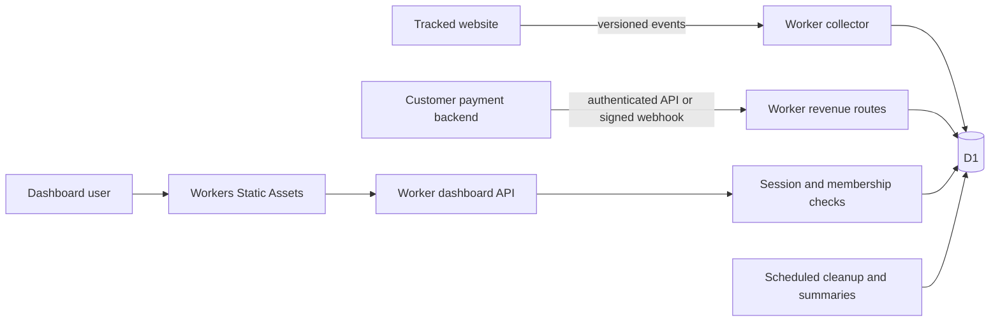

# Analytica implementation plan

Status updated 26 October 2026: the core application, original dashboard, tracker, revenue, authentication and privacy operations are implemented. The public repository and guided-deploy template exist. Remote hosted deployment, clean-account installation, capacity and restore evidence remain incomplete. See [current product inventory](current-product.md), the [selected next-work roadmap](product-roadmap.md) and [release evidence](operations/release-status.md). The phases below preserve the original planned acceptance criteria; their estimates and future-tense descriptions are historical planning context. Analytica remains a working name; name and domain availability are unverified.

## Product decision

Build an original analytics product for founders and small teams who want to connect traffic, conversions, and revenue. Ship one shared application with two installation modes: a hosted service in our Cloudflare account, and a self-hosted edition that users deploy into their own accounts.

Use Minilytics as a feature benchmark and a source of selectively reusable MIT code. Write new UI components, navigation, visual assets, documentation, tracker namespace, and customer-facing copy. The [assessment](minilytics-assessment.md) records the source evidence and reuse obligations.

The original planning task produced the phases below. Implementation has since produced the application, public repository and deploy-button configuration. A working hosted URL and verified clean-account deploy-button flow remain outstanding.

## Release scope

| Capability | First usable alpha | v1 release | Later |
| --- | --- | --- | --- |
| Accounts and sites | Invite-only hosted workspaces; self-host owner; multiple sites; enforced authorization, revocation and operator-assisted recovery | Self-service owner/admin/viewer management and recovery UI | More organization controls |
| Tracker | Pageviews, SPA routes, campaign/referrer, country/device, goals, outbound events; consent/opt-out and bounded retry | Engagement reporting and more installation integrations | More framework wrappers |
| Reports | Overview, acquisition, pages, goals, periods/comparisons, filters | Audience, saved filters, ordered funnels and journeys where identity is enabled | Cohorts, extra attribution models |
| Revenue | Disabled; synthetic demonstrations only | Generic payment/refund API, Dodo signed webhooks, reconciliation, matching explanations, per-currency totals | Stripe, Paddle, Lemon Squeezy |
| Deployment | Hosted staging and production; self-host proof of deployment | Public template button, upgrade and restore guide | Larger installation profiles |
| Operations | Tested admission/storage envelope, sanitized logs, scheduled retention, ingestion health, operator-supported export/deletion and recovery | Self-service usage/export/deletion UI, full capacity and restore drills | Queues, partitioning, archives as measured |
| Commercial model | Free invite-only alpha | Publish concrete quotas and retention; paid signup only after billing/recovery work | Subscription automation |

The customer alpha gate requires Phases 0-2 plus the minimum deployment, maintenance, recovery, export/deletion and capacity work explicitly included in Phases 1-2 below. Before that gate, use synthetic data only. Customer payments stay disabled until Phase 3 passes. v1 also requires Phases 3-5 and both deployment paths. Pricing and subscriptions are separate from attributing our customers' payments.

## Original interface and copy

Use a compact application shell with workspace/site switchers and dedicated pages: Overview, Acquisition, Pages, Events, Revenue, and Settings. Put audience details inside Overview initially; add an Audience page when the data warrants it. A persistent period selector, timezone label, and removable filter chips apply across reporting pages. Filters and date ranges live in the URL.

The initial design direction is warm off-white panels, dark ink text, a restrained cobalt accent, thin rules, and tabular numbers. Prioritize readable tables and one primary chart per view. Use separate traffic and money charts with aligned time axes rather than an ambiguous dual-axis chart. This direction requires a design pass and browser validation during implementation.

| Screen or state | User job and proposed copy |
| --- | --- |
| Overview | "What changed?" Show visits, conversions, revenue by currency, previous-period change, and a short list of the sources/pages behind the change. |
| Acquisition | "Which sources lead to signups and sales?" Start with sortable source/campaign rows. Recognize AI referrers through explicit rules; explain that hidden referrers remain unknown. |
| Pages | "Where do visits turn into action?" Entry pages, pageviews, exits, and goal filters, with exact metric labels. |
| Events | "Which actions are people completing?" Event setup, totals and conversion definitions, then ordered funnels in v1. |
| Revenue | "Which sales can we connect to a visit?" Payments, refunds, currency selector, attribution method, unmatched count, and integration health. |
| Installation | "Add your first site" → "Install the snippet" → "Check your first event". Offer a sample event that is visibly marked as test data. |
| Empty report | "No visits in this period." Offer a longer range and installation check. Do not show a connection failure as zero traffic. |
| Blocked tracker | "We haven't received an event yet." Show domain, snippet and browser-network checks. Explain tracking limitations. |
| Missing revenue match | "Payment recorded. No verified visit match." Keep the sale in total revenue and separate it from attributed revenue. |
| Freshness or partial data | Show last received event and last report update; explicitly label capped or incomplete results. |

Use fresh wording throughout. Avoid promises of perfect accuracy, automatic identification, universal consent exemption, or unlimited free hosting. Include keyboard navigation, accessible table/chart descriptions, color contrast, mobile layouts, and clear loading/error/retry states in the design acceptance checks. Maps, command palettes, generated AI insights, and complex animations are followups.

## Cloudflare architecture

Start with a TypeScript Hono Worker, React/Vite dashboard, Workers Static Assets, one D1 binding, and Cron Triggers. Pin a supported Wrangler release and commit the lockfile. Use current stable dependencies after verifying Worker compatibility in Phase 0. Do not copy upstream's dependency lockfile unchanged: local build/typecheck and 18 tests passed, but its dependency audit reported 9 affected entries, including development-tool findings marked high/critical. See the assessment for scope and advisory links.



Serve dashboard and tracker assets without executing the Worker where possible. Only explicit API, collection, health, and authentication routes should run Worker code. Confirm that missing API routes return JSON, never the SPA document. Keep authenticated report responses private; never place them in a shared public cache.

Worker-first routing must include `/api/*`, `/v1/*` and `/healthz`, with deliberate treatment of path roots. Test normal navigation and `OPTIONS`, unknown dynamic paths returning a JSON 404, and tracker/dashboard asset loads that do not invoke the Worker. Do not copy upstream's `/api/*`-only configuration unchanged.

Use one shared D1 database for the capped hosted alpha and one database per self-hosted installation. Every analytics table includes workspace and site identifiers. Require a server-created authorization context for dashboard queries; client-supplied workspace IDs never establish access. A later database-routing layer can move a large tenant or shard to a different database, but v1 does not depend on runtime database provisioning.

The first hosted release must have an explicit total capacity limit and per-site admission limits. A paid Cloudflare account does not make a single D1 database infinitely scalable. Apply backpressure instead of accepting traffic that cannot be persisted.

| Service | Initial decision | Condition for adding it |
| --- | --- | --- |
| Workers and Static Assets | Required | Runtime and asset delivery |
| D1 | Required | Source of truth for identities, events, sessions, reports and payments |
| Cron Triggers | Required | Bounded retention, expired auth records and report summaries |
| Turnstile | Hosted signup/login abuse control if signup is enabled | Server-side verification, with an explicit local test path |
| Queues | Optional after the direct-write baseline | Burst tests miss the acceptance budget. Add a dead-letter queue, retry/backlog alarms, and duplicate-safe consumers. |
| KV | Optional for non-sensitive site configuration only | Measured config-read load justifies eventual consistency. Never use it for immediate key revocation, owner setup, or workspace membership. |
| R2 | Optional | Large asynchronous exports or archive retention become a committed feature. Define deletion and restore behavior first. |
| Analytics Engine | Optional research path | Approximate high-volume traffic metrics are acceptable and sampling, retention, querying and deletion requirements are validated. Never use it as the payment ledger. |
| Durable Objects | Optional | Measured coordination or strict admission counters require them. Do not add them just for a live visitor badge. |

Queues provide [at-least-once delivery](https://developers.cloudflare.com/queues/reference/delivery-guarantees/). They do not reduce the number of indexed D1 rows written or remove D1's serial query execution. Analytics Engine [sampling](https://developers.cloudflare.com/analytics/analytics-engine/sampling/) also needs deliberate handling before it can replace exact report queries.

## Domain and schema contract

Write migrations with composite keys and constraints that keep references inside a workspace/site. Keep raw SQL in repository modules, not React components or route bodies. Use parameterized statements and a typed validation schema at each API boundary.

| Table group | Required records and invariants |
| --- | --- |
| Authentication | `users`, `auth_sessions`, `workspaces`, `memberships`, expiring single-use invite/recovery records. No shared global administrator cookie in hosted mode. |
| Sites and integrations | `sites`, `site_domains`, `api_keys`, `integrations`. Hash API keys; display once. Scope each key to site, operation, and revocation state. Encrypt integration secrets with a Worker secret that supports key versioning. |
| Collection | `events` keyed by workspace/site/event ID; `visitors` and `sessions` keyed by workspace/site/identifier. Schema version, event time, received time, privacy mode and source classification version are explicit. |
| Revenue | `payment_events`, `payments`, `refunds`, `attribution_links`, signed checkout claims. Distinguish delivery receipts from canonical transactions scoped to workspace/site/provider/merchant account. Keep economic identity independent of integration or webhook delivery ID. |
| Reports | `funnels`, summary tables and summary checkpoints. Each summary carries definition version, coverage interval, and freshness. |
| Operations | Usage counters, bounded audit records, deletion/export jobs and maintenance checkpoints. Never log raw visitor payloads or secrets. |

Indexes should begin with workspace/site and then the relevant time or lookup column. Benchmark time-range, visitor, session, payment and acquisition queries; don't index every dimension by default. Index writes count too.

### Ingestion and metric rules

1. The tracker is a small independent package with an `analytica` namespace and versioned event envelope. Give each logical event a random ID that survives retries. Bound payload bytes, field lengths, property count, event rate and retry storage. Do not persist an unbounded offline queue.
2. The server derives workspace/site from an enabled public site ID. Validate exact host allowlists and browser Origin where available. These deter accidental misuse; public tracking keys and headers cannot prove a human visit. Keep sensitive identity and payment mutation behind authenticated server APIs.
3. Apply event deduplication and every derived session/counter mutation atomically. A plain `INSERT OR IGNORE` followed by an unconditional increment is insufficient. Phase 0 must prove an insert-gated SQL batch/trigger design under concurrent duplicate delivery in D1 before implementation depends on it.
4. Use received time as the authoritative intake clock, with bounded client time for sequencing. Initial proposal: accept up to 24 hours of lateness and 5 minutes of future skew, otherwise reject or quarantine with a reason. Order within a document by bounded client monotonic sequence, then event time and event ID. An ingestion sequence is an audit tie-breaker, not proof of action order across documents. Store the ordering rule/version with funnels.
5. A session ends after 30 minutes without page navigation or an explicit tracked interaction. A visibility heartbeat measures engagement but does not renew inactivity. Validate that a session belongs to its visitor/site, cap duration deltas, and separate last engagement, last interaction, and last received timestamps.
6. Pageview totals use event time within a selected interval. Session counts use session start time. Distinct visitor IDs apply only to attribution mode and retained detail. Aggregate mode reports pageviews/events and document-session estimates, never a combined "people" count. Goal conversion is sessions starting in the period that complete the goal within that session divided by eligible sessions starting in the period; flag the current period as provisional. Revenue by payment date is a financial total, not a visitor-cohort conversion rate. Do not divide unmatched purchases or purchases credited to an earlier period by this period's visitors. Do not derive event totals by summing counters of sessions that started inside the range.
7. Convert site-local date boundaries to UTC with IANA timezone rules, including DST. Previous-period comparisons use the documented interval rule. Revenue uses payment/refund occurrence time; attribution links to a qualifying session that can precede the report window.
8. Start with a fixed 30-day last non-direct attribution window. Store model version, selected session, matching method and evidence timestamp. Unmatched payments remain unmatched. Browser return URLs alone cannot prove identity. Timing-based matching is disabled for v1.
9. Represent money as bounded integer minor units plus validated ISO currency/exponent. Accept generic API amounts in minor units. Keep currencies separate. Support distinct partial refunds, refund-before-payment arrival, retries and corrections without double counting.
10. Funnels are explicitly ordered, session-scoped and available only in attribution mode in v1, with a maximum 30-minute completion window. Require a distinct event for each repeated step, and advance at most one step per event. Bounds and exclusions are visible. Persistent cross-session funnels are deferred. Aggregate mode does not offer funnels, returning visitors or journeys.
11. Simple daily sums can summarize pageviews and money. Daily unique visitors cannot be summed into monthly unique visitors. Use exact distinct sets from retained data or an approved explicit approximate metric. Arbitrary filters and journeys must not claim precision beyond retained detail.
12. Define bounce as one pageview and no goal in a session. Label it and distinguish it from engagement. "Online" is an estimate based on a documented recent visibility window, not an authenticated user count.

### API outline

Proposed routes, subject to the Phase 0 contract review:

```text
POST /v1/collect                         public bounded telemetry
POST /v1/server/events                   scoped server key
POST /v1/server/payments                 scoped server key, idempotent
POST /v1/server/refunds                  scoped server key, idempotent
POST /v1/webhooks/dodo/:integrationId     raw-body signature verification
POST /api/setup                         self-host bootstrap proof only
/api/auth/*                             login, logout, recovery, session revoke
/api/workspaces/:wid/sites/*             membership and role required
GET  /api/workspaces/:wid/sites/:sid/reports/*
POST /api/workspaces/:wid/sites/:sid/exports
POST /api/workspaces/:wid/sites/:sid/deletions
GET  /healthz                           minimal process/schema readiness
```

Use stable error codes and request IDs. Collection returns success only after its atomic database write, or after a durable queue acceptance if a queue is added. A transient storage failure must not be acknowledged as stored. Rejected/bot/duplicate events have distinct internal metrics without exposing user data.

### Atomic intake, summaries, and admission

These contracts are proposed SQL designs to prove in Phase 0, not established D1 behavior of this application.

- Canonicalize and hash the validated logical envelope. Reusing its scoped event ID with the same digest returns duplicate success without new counters or quota charges. Reusing it with changed content returns a conflict. Retain compact receipts for every event class, including engagement, for 90 days. Valid clients retry for at most 24 hours and preserve the original timestamp/content. Older events are rejected; this is a bounded deduplication promise, not permanent replay protection against a malicious public sender.
- In one insert-gated transaction, verify authoritative site state and applicable key state, check a D1 usage counter against per-site and installation limits, insert the new receipt, and apply derived session/counter mutations. Test the precise trigger/batch construction and failure paths. Rejected and duplicate requests must not unconditionally increment usage or create rows. Use approximate edge throttling to reduce floods before D1, and reserve budget for auth, reports and maintenance. If a tested D1 design cannot enforce admission within its budget, revise the architecture before customer intake.
- Freeze session start and entry attribution when established. A valid late event can update ordered detail and mark a session/bucket dirty but cannot reopen an expired interaction session. A post-idle action starts a new session; a heartbeat cannot do so. Use event time/sequence for entry/exit within an established session and received time for the inactivity admission check. Quarantine ambiguous late session association rather than moving old events silently.
- Recompute dirty summary buckets from retained authoritative records and replace the bucket plus its checkpoint atomically. A replayed job yields the same result. A late accepted event, refund, correction or allowed rematch marks affected buckets dirty. Exact distinct queries still use retained detail; do not increment a monthly unique counter from daily counts. Cap work per invocation and persist resumable progress.
- Site deletion first commits an authoritative `deleting` state that prevents new intake and summary work, then deletes in bounded batches. Workers must check that state in the same transaction as mutations; cached enabled-site metadata cannot authorize intake. Workspace deletion does the same for every site. Test intake, key revocation, membership removal and jobs racing deletion across independent requests. Fail closed on missing authoritative state.

### Revenue identity and checkout trust

Webhook event IDs deduplicate deliveries. Canonical transaction identity additionally includes workspace/site, provider, merchant account and the provider's transaction ID. Two integrations for the same merchant must converge on that namespace; unrelated merchants with equal transaction IDs stay separate. Generic-only merchants declare an authenticated external namespace. By default one configured intake path owns a merchant's sales. Reject overlapping generic/webhook intake unless an explicit shared provider transaction mapping is configured. Never assume different delivery IDs imply different sales.

For payments and refunds, repeated keys with changed economic content return a conflict. Corrections use explicit immutable adjustment records with their own IDs and audit history. Every partial refund has an independent ID, references its original transaction and uses the same currency. Refund-before-payment is visible as pending and excluded from confirmed net totals until the original is verified. Quarantine cumulative refunds above the original amount or inconsistent currency, rather than silently altering the sale. Define the operator resolution path and disclose pending amounts in the report.

Only a merchant backend authenticated by an appropriately scoped server key can issue a checkout correlation. Bind its signed claim to workspace/site, integration/merchant, a known checkout ID, consent-eligible visitor/session, purpose, expiry and random nonce. Store the allowed checkout-to-transaction mapping and key version. The public collector cannot mint a claim or attach customer identity. If the provider reveals the transaction ID later, only its verified webhook or authenticated merchant backend can bind it to the issued checkout.

Consume claims once, atomically, against that verified checkout mapping. A browser return can present an existing claim but cannot supply a new transaction/visitor association. Keep delivery-order state so webhook-before-return and return-before-webhook converge without losing the claim. Expire unused claims after 24 hours; retain consumed nonce receipts with the payment for 13 months. Rotate signing keys with explicit verification windows. A valid claim proves backend correlation, not a verified human visit. Aggregate-mode payments remain unmatched to persistent browser identity. Installation snippets and generated assistant prompts must contain only public site IDs and placeholders, never webhook secrets or server keys.

## Identity, privacy, and retention

Offer explicit site modes. Default aggregate mode uses no persistent visitor cookie or fingerprint. Generate in-memory document IDs and rotate them after inactivity. Full document navigation loses the ID, while SPA navigation can retain it. Report pageviews/events and labeled document-session estimates with that limitation. Disable unique-person/returning-visitor claims, identify, funnels, persistent journeys and cross-session attribution in this mode. Do not combine attribution-mode IDs with document IDs in a distinct-person metric. Saved filters retain their selected mode.

Attribution mode enables first-party random visitor/session identifiers only after the site's configured consent condition. Provide an explicit `consent`/`optOut` API, no implicit consent claims, and no replay of pre-consent history. Keep email/name out of browser collection in v1. Where a customer intentionally supplies identity server-side, apply role restrictions, redaction, retention and deletion to it. Do not advertise either mode as automatically exempt from consent law.

Send paths plus allowlisted campaign fields, never arbitrary URLs or fragments. Provide path redaction for account IDs and sensitive routes. Apply property allowlists and remove known secrets again at intake. Do not store raw IP addresses for analytics; any short-lived abuse identifier must have a defined TTL and stay outside analytics reports.

Proposed defaults: raw analytics detail, sessions and visitor records retained for 90 days; hourly/daily aggregate totals for 13 months; non-identifying financial records and sanitized attribution snapshots for 13 months unless a site owner chooses a shorter supported window. Never retain indefinite browser identity to support a short report window. Attribution only uses the last 30 days of eligible evidence. Time Travel recovery has its own provider retention and must be described in deletion documentation.

Retention runs in small resumable batches and records coverage. Expired detail disables or narrows journey, exact unique and arbitrary-filter reports. Older summaries offer additive counts only, with a visible coverage label. Delete-site and delete-workspace jobs cover detail, summaries, keys, identity, payment links, caches, and optional exports/archives. Export via authenticated, size-capped streaming for v1; add R2 only when larger export jobs are required.

Payment retention does not depend on retaining analytics sessions. On verified matching, persist a minimal attribution snapshot on the ledger with model version, matching method, source/channel, bounded campaign label and evidence date. Snapshot fields remain subject to sanitization and deletion policy. Do not copy arbitrary properties, full referrers or visitor identity into it. Retain this financial snapshot for 13 months with the transaction; later refunds inherit it. Keep identity fields in a separately erasable record with a 90-day default. At detail expiry, clear visitor/session/customer identity references and delete those records without cascading to retained money. The migration must implement nullable composite references with tested explicit unlinking, not a ledger deletion cascade. Rematching after eligible detail/claims expire is unavailable; record that reason.

| Data or feature | Within 90 days | After detail expiry, up to 13 months |
| --- | --- | --- |
| Pageview/event totals | Retained events and versioned summaries | Additive totals only |
| Traffic filters | Retained dimensions and detail | Only independently stored daily source/channel, page, country and event-name totals; no arbitrary combinations |
| Distinct IDs, sessions, journeys, funnels | Defined by privacy mode and retained detail | Unavailable; never infer them from sums |
| Revenue and refunds | Ledger totals by currency and verified attribution snapshot | Same ledger/snapshot totals without visitor/customer identity or journey links |
| Source/campaign revenue filters | Payment snapshot dimensions, with unmatched bucket | Same snapshot dimensions; unsupported dimension combinations are disabled |
| Checkout evidence | Unused claim expires at 24 hours; consumed nonce retained with payment | Consumed nonce receipt and minimal correlation audit only, no expired browser identity |

Store summary timezone and definition version. After a site timezone changes, retained raw data can be recomputed; older summaries remain explicitly labeled with their original timezone and cannot be falsely rebucketed. Test midnight, spring-forward and repeated fall-back hours rather than reusing upstream's one-offset-per-range bucketing.

Individual identity erasure removes personal attributes and visitor/session links from all covered records, and reclassifies any affected identifiable dimension values. Keep only sanitized non-personal financial totals/snapshots according to the published policy; a request requiring erasure of the whole transaction must use the ledger deletion/rebuild path. Delete-site/workspace removes ledger and all summaries too. Maintain a protected deletion journal for the provider recovery window, containing the minimum scoped opaque IDs required to reapply deletions. After a restore, block normal access until that journal is reapplied and summaries reconcile. Explain provider recovery retention separately from active-data deletion.

## Authentication and deployment modes

Use a maintained Worker-compatible authentication library with D1 storage after a Phase 0 compatibility spike. Better Auth is the first candidate, not yet a verified dependency. Its adapter support, password hashing, migration tooling and required compatibility flags must be checked against primary documentation and exercised in the Worker runtime before selection. Keep permission checks in our own authorization module and never rely on a UI role flag.

For the hosted alpha, provision invite-only accounts and workspaces. Support secure HttpOnly/Secure cookies, CSRF/Origin protection, password hashing within the Worker budget, session expiry/revocation, rate limits and a tested recovery process. Do not enable public email signup without a validated ownership-verification and recovery delivery path. Cloudflare Email Routing alone must not be assumed to send transactional email. Evaluate the separate [Cloudflare Email Service](https://developers.cloudflare.com/email-service/) for account eligibility, sending restrictions, domain verification, delivery/recovery and cost before selecting it; its documented beta does not prove access in our account or in every self-hoster's account. No external mail/auth service is an assumed dependency.

The Phase 0 auth decision must record library version, D1 adapter/schema migration behavior, compatibility flags, password algorithm/security parameters, memory and bundle size. Measure owner creation, successful/failed verification and recovery on both profiles. Free Workers have a 10 ms CPU budget for HTTP and scheduled invocations. Record tail CPU and actual resource-limit failures for auth, reports, cleanup, summary and deletion jobs; a passing average or p95 is insufficient. Never weaken password hashing to fit the tier. If it fails, choose a tested passkey/recovery profile or state a paid requirement before advertising free self-hosting. Passkeys require an RP ID/origin and a migration/recovery policy when moving from `workers.dev` to a custom domain.

For self-hosting, use the same schema with one owner workspace. Require a user-supplied high-entropy setup token and application secret entered in Cloudflare's secret fields. A public first visitor must never be allowed to claim an unconfigured installation. Keep setup proof out of URLs, logs, assistant prompts and analytics. Atomically create user, workspace, membership and consumed setup state; close all alternative signup paths. Then permanently close bootstrap unless the account owner deliberately performs a documented recovery operation. Never include a real default password or usable token in source or examples. Test concurrent different owner claims, failure after each setup mutation, restart, upgrade and restore. Recovery never reopens public registration.

The hosted and self-hosted modes share tracker, analytics, schema migrations, permission module, and UI. Feature flags change signup, provisioning and commercial controls. Tests must run against both modes.

## Hosted deployment

Target Cloudflare account `ee587f9d5cc45b6fb0bc096bf85487b8` only after checking it against the account supplied for deployment and privately re-entering fresh credentials. Verify the account ID and available resources during deployment preflight. Do not store the pasted token. Use `CLOUDFLARE_ACCOUNT_ID` for Wrangler or an explicit account configuration; do not assume `CLOUDFLARE_DEFAULT_ACCOUNT_ID` is the Wrangler selector. Verify the selected account before any mutation.

Create isolated staging and production Workers/D1 resources, independent secrets and synthetic staging data. Use Workers Builds from our repository, explicit migration/deploy scripts, a schema readiness endpoint, and a verified `workers.dev` URL first. A custom domain is a separate DNS setup after the name is selected. No production metrics should mix with the demo dataset. Test CI's ability to apply remote D1 migrations with its actual build credential. Permission names in a documentation list are insufficient evidence that a particular build token can migrate. Scope deployment credentials to the selected account/resources and keep runtime secrets separate from build-time secrets. No untrusted preview build may receive production credentials or use production D1.

Deploy additive schema changes before compatible application versions. Retain a known-good Worker version, test rollback against the expanded schema, and use forward fixes for destructive schema changes. Restoring D1 Time Travel can lose later writes; it is an incident procedure, not the normal rollback button. Rehearse a restore and key rotation before public v1.

## Deploy to Cloudflare edition

Cloudflare supports a [deploy button](https://developers.cloudflare.com/workers/platform/deploy-buttons/) backed by a public Git repository, resource provisioning and Workers Builds. "One click" means starting that guided flow. Users still authenticate, select an account/repository and provide installation secrets. Our acceptance target is no terminal and no database-ID editing for the normal path.

1. Publish a reviewed, versioned repository/template. Add a button pointing to that actual repository. The repository owner and URL remain to be chosen; no functioning button can be claimed before publication.
2. Include minimal D1 and Static Assets configuration and safe descriptive metadata. Validate default bindings against the real button flow. CLI automatic provisioning can omit resource IDs; button guidance also discusses template defaults. Do not assume these paths behave identically without testing.
3. Provide repository-root `build` and `deploy` scripts. Run migrations through the binding name, for example `wrangler d1 migrations apply DB --remote`, then deploy using the identical environment/config selection. The provisioning-before-migration order must pass a fresh-account test. No migration should execute on an ordinary page request. Record the pinned Wrangler version, root commands, rewritten effective configuration, actual credential scopes and runtime/build secret separation. If the guided flow requires manual creation of an extra API token, record that friction and resolve it before claiming the no-terminal normal path is ready.
4. Declare required secrets through `.dev.vars.example` with intentionally unusable placeholders and descriptions, verify the button prompts for them, and fail closed if they are missing or unchanged. Community reports suggest example values may be prefilled; treat that as an unverified test case, not a platform guarantee. Test the untouched default path as an attacker would see it. Evaluate whether the UI supports generated secrets; otherwise give concise browser-based generation instructions. Do not claim automatic secret generation until verified, and do not require a terminal in the advertised guided-button path.
5. After deployment, show a token-protected owner setup page and then site installation. Store no Cloudflare deployment API token in the running app. Self-hosted analytics does not require Cloudflare control-plane access at runtime.
6. Verify a second deployment, an application update, renamed database/Worker, an existing resource name collision, interrupted migrations, retry after failure, and a parallel bootstrap race. Upgrades preserve analytics and never recreate the owner/database.
7. Supply an optional CLI fallback with explicit database creation and secret prompts for users who cannot use the button. This fallback does not satisfy the no-terminal deploy-button acceptance gate by itself.

An account/project with pre-existing resources is insufficient evidence that fresh self-hosting works. Do not advertise the button as ready until the recorded clean deployment and upgrade checks pass.

## Capacity and cost budget

Reference facts verified on 26 October 2026:

- Workers Paid starts at $5/month and includes 10 million dynamic requests and 30 million CPU milliseconds per month. Static-asset delivery is priced separately from dynamic invocations. See [Workers pricing](https://developers.cloudflare.com/workers/platform/pricing/).
- D1 Free allowances are 5 million rows read/day, 100,000 rows written/day and 5 GB account storage. Indexed-column mutations add writes. Paid includes 25 billion reads/month, 50 million writes/month and 5 GB storage. See [D1 pricing](https://developers.cloudflare.com/d1/platform/pricing/).
- Storage and per-database throughput are independent constraints. Budget for the [500 MB free / 10 GB paid database limits](https://developers.cloudflare.com/d1/platform/limits/).

Model traffic before publishing price claims:

```text
dynamic requests = pageviews + goals + outbounds + engagement + API/auth/report calls
D1 writes = accepted event inserts + dedupe/session/summary mutations + index work
            + auth/payment maintenance + retention/deletion work
D1 reads = collection lookups + auth checks + scanned report rows + maintenance
stored bytes = retained detail and indexes + summaries + auth and payment records
```

Illustrative planning load: 100,000 pageviews/month, 30,000 goal/outbound events, and 100,000 engagement updates yields about 230,000 collection requests before dashboard/auth traffic. At an assumed average of 8 billed row writes per collection request, that is 1.84 million row writes/month, or about 61,333/day if evenly spread across 30 days. A quiet small installation could fit the daily free write allowance, but daily spikes, indexes and storage can invalidate that estimate. This is an assumption to measure, not a benchmark or price guarantee.

At that load, 90-day retention contains about 390,000 non-engagement events plus 300,000 compact engagement receipts. A decimal 500 MB across 690,000 records permits only about 725 bytes per record before allowing for all other tables and indexes. This is a sizing illustration, not an observed row size. Measure storage at the complete proposed retention ceiling, including receipts, summaries and indexes, rather than just at a 100,000-event report fixture. Record peak size and size after cleanup; account for staging and other workloads sharing account allowances. Reduce retention/admission promises or require Paid if the measured free envelope cannot fit with maintenance headroom.

For comparison, 1 million pageviews/month at the same ratios yields about 2.3 million collection requests and 18.4 million writes before other work. Even if included paid request/write allowances cover that average, database size, CPU, read scans and burst throughput may be the limiting factors. Measure actual rows and compressed/uncompressed indexed storage from fixtures before setting retention and site quotas.

Initial operational targets, pending the spike: healthy collection acknowledgement p95 below 300 ms at 10 requests/second sustained and a 50 requests/second one-minute burst; a 30-day report p95 below 1.5 seconds at 100,000 retained events while collection continues. Set hosted admission limits below the tested envelope. Free-mode auth CPU and query limits must pass separately. Test long path matching without assuming SQLite's unrestricted GLOB behavior: the documented D1 LIKE/GLOB pattern limit is 50 bytes. Alerts should cover DB errors, write/read consumption, storage growth, failed cleanup, payment webhook rejection and optional queue backlog. Warn at 70% of the selected capacity budget and apply controlled limits before exhaustion.

## Delivery phases and acceptance

Estimates assume one experienced engineer, part-time design input, and review time. They are planning ranges, not commitments. Dependencies and pass criteria determine completion.

| Phase | Work and dependency | Exit evidence | Estimate |
| --- | --- | --- | --- |
| 0. Prove the platform | Minimal root Worker/assets/D1; auth and maintenance CPU; atomic dedupe/admission/summary prototypes; checkout and retention contracts; deploy-button ordering | Decision record for every gate in the review, reproducible fixtures, measured runtime limits and fresh-account configuration/permission evidence | 3-5 days |
| 1. Build the core | Depends on 0. Workspace/site/auth, revocation/recovery, keys, tracker, privacy/opt-out, quotas, bounded retention and operator export/deletion | Two-workspace and owner-race tests; atomic duplicate/conflict/session fixtures; redacted payloads; maintenance and deletion/intake race checks | 5-7 days |
| 2. Make reports useful and gate alpha | Depends on 1. New shell, onboarding, reports, dates/filters, usage diagnostics; isolated staging/production and self-host proof; baseline capacity | Seeded totals and DST tests; accessible error/empty states; recovery and operator export/deletion; full customer alpha checklist and measured admission envelope | 4-6 days |
| 3. Add trustworthy revenue | Depends on 1 and 2. Canonical ledger, generic API, partial refunds, Dodo webhooks, trusted signed correlations, matching UI and ordered funnels | Cross-input dedupe/conflict fixtures; webhook/return permutations; multi-refund/currency reconciliation; 90-day expiry/identity erasure fixtures; unmatched/pending states | 5-7 days |
| 4. Release both modes | Depends on 0-3. Public template, self-service operations, upgrade/restore guides, complete hosted/self-hosted release | Working hosted URL; clean button installation and update evidence; recovery drill with deletion journal; no secrets in git/bundle/logs | 3-5 days |
| 5. Validate full v1 capacity | Baseline measurements are required before alpha; expand concurrently with 2-4 for complete revenue/report/maintenance behavior | Full retention-ceiling storage/load/cost evidence, measured limits below the envelope; optional queue/sharding decision; both deployment profiles pass | 2-3 days |

Allow roughly 5-7 weeks for a reviewed v1, subject to Phase 0 outcomes. The deployed invite-only customer alpha follows Phase 2 only when every item in the gate below passes; it has no customer payment collection or funnels. Public paid SaaS also requires verified signup/recovery, abuse response, terms/privacy disclosures, pricing and subscription entitlements. Do not call the alpha a complete commercial service.

### Customer alpha gate

Every item is mandatory before storing external customer visitor activity. An incomplete build can be a synthetic-data demo only.

- Workspace/site authorization, key and session revocation, logout, operator-assisted recovery and isolated staging/production resources pass their negative tests.
- Consent/opt-out, aggregate-mode labels, redaction, bounded retry/intake/storage and privacy disclosures match actual tracker behavior.
- Scheduled retention and operator-supported export, identity erasure and site/workspace deletion work, including concurrent intake and maintenance. A basic restore/deletion-journal procedure is tested.
- Actual target-tier auth/report/maintenance CPU, full proposed retention storage and mixed traffic pass a documented baseline envelope. Set per-site and installation limits below it, preserving auth/cleanup capacity.
- Hosted and private self-host proof each demonstrate install → first event → report → export → deletion. The public deploy button remains a v1 gate. Payment routes stay disabled until Phase 3's ledger and trust tests pass.

### Required verification

Use Vitest with the Cloudflare Workers test integration for Worker/D1 behavior and Playwright for real browser tracker and dashboard flows. Use deterministic clocks and fixture data where timing affects metrics.

- Concurrent duplicates mutate event totals and session/goal counters exactly once; a failed batch leaves no partially updated state. Repeat when adding queue delivery.
- Changed-content duplicate IDs conflict, duplicate usage charges are zero, maintenance checkpoint retries are safe and late/corrected records rebuild the affected summaries.
- Forged site/workspace/session IDs never read private data or attach server-side identity; all routes, exports and keys enforce roles.
- Refresh, SPA routing, back/forward, multiple tabs, consent change, opt-out, blocked cookies, bot traffic, late events and inactivity produce the documented metrics.
- Payment/refund delivery order, replay, currency exponent, stale signature, provider event collision and correlation-token reuse produce correct ledger and attribution behavior.
- One sale received via generic API and webhook cannot duplicate revenue; swapped visitor/cross-site checkout claims and untrusted metadata cannot attach identity. Partial refunds, pending originals and excessive cumulative refund amounts follow the documented rules.
- A report with seeded DST boundaries, midnight-spanning sessions and repeat visitors returns defined counts; older rollups never sum distinct visitors or hide a cap.
- Cleanup and deletion remove the promised records and expose actual retention coverage. A schema failure produces a recoverable setup error without leaking credentials.
- Advance detail beyond 90 days, then refund, filter revenue, erase identity and delete the site; verify retained snapshots and remaining columns. Restore must reapply the deletion journal before access resumes.
- Hosted staging and self-host clean-account flow each support install → first event → report → payment → export → deletion, then update and rollback/restore rehearsal.
- Run typecheck, lint, unit/integration tests and production build in CI. Load tests must record the fixture size, region, tier, query plan, rates and observed resource usage.

## Repository layout for implementation

```text
apps/worker/             Hono routes, auth, services, repositories, scheduled work
apps/dashboard/          React app, original UI and reporting screens
packages/tracker/        browser tracker, small bundle and browser fixtures
packages/contracts/      event schemas, metric definitions and API types
migrations/              reviewed forward SQL migrations
tests/                   Worker/D1 integration, browser and capacity fixtures
scripts/                 deploy preflight, synthetic data and release checks
docs/                    product/architecture decisions and operations guides
wrangler.jsonc           minimal self-host template; hosted environments isolated
```

Start as one npm workspace and one deployable Worker, built from the repository root. The deploy button must target that root; do not target `apps/worker` while it depends on sibling workspace packages. A split collector/report Worker becomes useful only if deployment independence or measured traffic warrants it. No Docker, external database, paid auth service or control-plane token should be required for the default self-host installation.

## Decisions still required

The plan can proceed with the defaults above. Before external launch, choose the final product name/domain and public repository owner, decide whether v1 includes public paid signup, and confirm the retention/support promises. Before deployment, privately supply a fresh least-privilege Cloudflare credential and verify the target account. During Phase 0, resolve the auth-library choice, exact secret UX, atomic SQL approach and clean-account migration ordering with executable evidence.

## Agent findings and review status

Antigravity proposed dedicated task-oriented reporting, a setup wizard and explicit unmatched-revenue states. Adopt these ideas with the simpler initial scope above. Defer multi-touch attribution, multiple payment vendors, advanced maps, AI summaries, KV, R2 and Analytics Engine until their value and operational requirements are established. Its report is research input, not a tested implementation specification.

GLM independently confirmed the auth, public ingestion, session, geolocation and storage-limit risks and identified D1's 50-byte LIKE/GLOB pattern limit. Adopt explicit tenancy, hashed keys, duplicate-safe intake and bounded deletion work. Reject its proposed IP/UA fingerprint, implied EU-only deployment mode, success response for discarded quota-limited events, KV-based strict auth counters and unmeasured shared-database throughput estimates. They conflict with this plan's privacy, delivery and consistency rules.

DeepSeek recommended one required store, one deploy unit, and a separate test matrix for secrets, renamed resources and migration permissions. Adopt those recommendations and rename all public tracker interfaces before the first installation. Its request/write cost estimates remain illustrative, particularly at large volume where single-database storage and throughput must be measured. The final budget must include the base plan, CPU, writes, reads, storage, builds and observability. See the [research reconciliation](research/README.md).

GPT-6.1 Sol completed an independent [source and plan review](research/sol-review.md). Its four P1 findings led to the single customer-alpha gate, surviving financial attribution snapshots and explicit erasure rules, end-to-end idempotency/summary contracts, and authenticated checkout correlation. Its P2 findings added free HTTP/Cron CPU gates, precise aggregate/session/DST rules, authoritative quota/deleting-state transactions, root-template routing/permission evidence and retention-ceiling storage measurements. The [disposition record](research/review-disposition.md) maps every finding to the plan correction. These are planning corrections by the primary agent; no second review or runtime validation is claimed.
