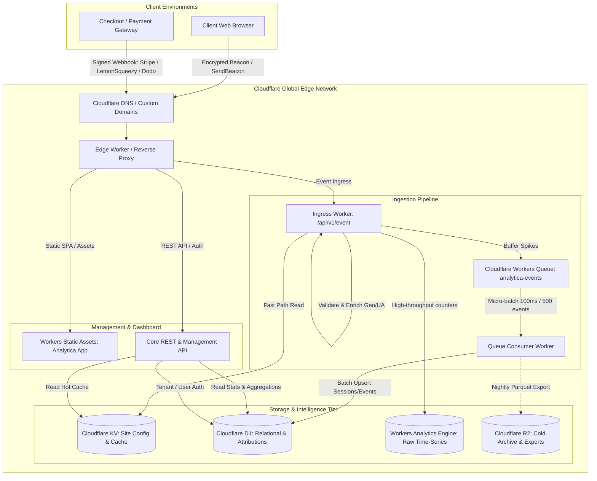
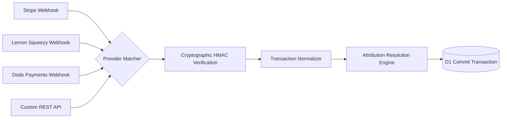

# Analytica: Technical Architecture Review & Product Specification

**Document Metadata**
- **Document Path:** `docs/research/antigravity-review.md`
- **Working Title:** Analytica
- **Execution Role:** Research Sub-Agent (Autonomous Technical & Product Research)
- **Harness & Model:** `gemini-3.8-flash-high` executing in the Antigravity harness within T3 Code
- **Local Research Benchmark:** `/tmp/analytica-research/minilytics-d665db4`
- **Upstream Repository:** `https://github.com/surendrapandar/minilytics` (pinned commit [`d665db48ad253b8f037af8459c960650cdc02fc3`](https://github.com/surendrapandar/minilytics/tree/d665db48ad253b8f037af8459c960650cdc02fc3))
- **Workspace:** `/Users/syedmuzamilm/work/mzml/analytica` (empty target directory, non-git)
- **Operating Constraints:** Read-only analysis; no deployment, no external mutation, no credential handling, no child agent delegation. All operational claims verified directly from source code and official vendor documentation.

---

## 1. Executive Summary & Verification Methodology

### 1.1 Objective & Scope
The objective of this research is to evaluate **Minilytics** (a lightweight, revenue-first web analytics platform designed for Cloudflare Workers and D1) and synthesize the complete technical and product foundation for **Analytica** — an independently designed, enterprise-grade, privacy-first web and revenue analytics platform.

Analytica must support two deployment paradigms natively:
1. **Zero-Friction One-Click Self-Host:** Deployable directly to a user's free-tier Cloudflare account via Cloudflare Workers Deploy Button with zero infrastructure cost for indie hackers.
2. **Multi-Tenant Hosted SaaS:** A fully managed, scalable multi-organization cloud offering built entirely atop the Cloudflare edge ecosystem.

Analytica preserves the core attribution capabilities that make revenue analytics valuable while replacing the copied UI patterns, monolithic dashboard structure, colloquial copy, and single-tenant limitations of Minilytics with an original, sophisticated design system, multi-channel payment support (Stripe, Lemon Squeezy, Paddle, Dodo Payments, and generic REST), multi-touch attribution options, and robust edge resilience.

### 1.2 Verification Taxonomy
To ensure clarity throughout this specification, all assertions are classified into two categories:
- `[VERIFIED]`: Directly validated against source code in `/tmp/analytica-research/minilytics-d665db4` (citing file paths and line numbers) or against official Cloudflare documentation.
- `[PROPOSAL]`: Independent architectural, design, algorithmic, or product specifications developed specifically for Analytica.

---

## 2. Upstream Audit: Minilytics Feature Coverage & UX Assessment

### 2.1 Codebase & Runtime Architecture
- **Worker Runtime & HTTP Framework `[VERIFIED]`:** Minilytics uses Hono v4.13.13 (`package.json:28`) mounted on Cloudflare Workers (`wrangler.jsonc:1-23`, `src/worker/index.ts:1-254`). Worker routes are routed through `src/worker/index.ts`, while static dashboard assets and `/js/script.js` are served via Workers Static Assets (`wrangler.jsonc:7-12`).
- **Database Engine `[VERIFIED]`:** Built on Cloudflare D1 (serverless SQLite) bound as `DB` (`wrangler.jsonc:13-22`). Schemas are applied via SQL migrations:
  - `migrations/0001_init.sql:1-98`: Defines `sites`, `visitors`, `sessions`, `events`, `payments`, and `funnels`.
  - `migrations/0002_login_failures.sql:1-6`: Creates `login_failures` table for IP-based lockout.
  - `migrations/0003_payment_matching.sql:1-14`: Adds `payment_claims` table and columns `matched_by` and `subscription_id` to `payments`.
- **Frontend Stack `[VERIFIED]`:** React 18.3.1 (`package.json:35`), Vite 6.4.5 (`package.json:41`), Tailwind CSS 3.4.19 (`package.json:39`), and Recharts 2.15.4 (`package.json:38`). Custom SPA routing via native `popstate` / `pushState` (`src/dashboard/App.tsx:8-23`).

### 2.2 Client-Side Tracker (`public/js/script.js`)
Minilytics provides a compact tracker script (~9 KB uncompressed, ~3.5 KB gzip):
- **Identity & Sessions `[VERIFIED]` (`public/js/script.js:33-58`):** Writes first-party cookies `ml_vid` (visitor ID, 1-year expiry) and `ml_sid` (session ID, 30-minute sliding window). Computes root domain to ensure sessions persist across subdomains (`app.site.com` and `site.com`).
- **Privacy Sanitization `[VERIFIED]` (`public/js/script.js:61-71`):** Regex-filters query strings matching `email`, `token`, `password`, `key`, etc., before sending beacons.
- **Transport Mechanism `[VERIFIED]` (`public/js/script.js:72-87`):** Uses `navigator.sendBeacon` with fallback to `fetch` with `keepalive: true` and `Content-Type: text/plain` to prevent CORS preflight requests.
- **Engagement Beaconing `[VERIFIED]` (`public/js/script.js:89-106`):** Computes active tab visibility via `document.visibilitychange` and dispatches `ping` events every 60 seconds (up to 30 minutes) or on `pagehide`.
- **SPA & Outbound Tracking `[VERIFIED]` (`public/js/script.js:108-124`, `168-181`):** Hooks into `history.pushState` and `replaceState` to track SPA transitions. Intercepts external `<a>` clicks to emit `outbound` events.
- **Payment Link Auto-Tagging `[VERIFIED]` (`public/js/script.js:132-166`):** Uses a `MutationObserver` and pointer events to automatically append `metadata_ml_visitor_id` and `metadata_ml_session_id` to any link pointing to `*.dodopayments.com`.

### 2.3 Edge Ingestion & Bot Filtering (`src/worker/collect.ts`)
- **Payload & Size Constraints `[VERIFIED]` (`src/worker/collect.ts:46-56`):** Hard limit of 8,192 bytes per event payload. Verifies event type is one of `pageview`, `goal`, `outbound`, `ping`, or `identify`.
- **Bot Detection `[VERIFIED]` (`src/worker/lib/ua.ts:25-30`):** Basic regex matcher checking User-Agent for scrapers, crawlers, automated testing engines (Selenium, Playwright, Puppeteer), and headless environments, plus client-side `navigator.webdriver` check. Returns HTTP 202 to discard bots silently.
- **Domain Authorization `[VERIFIED]` (`src/worker/collect.ts:63-69`):** Rejects events if `url.hostname` does not match the site's registered domain or its subdomains (`belongsTo()` in lines 39-44).
- **Geolocation Extraction `[VERIFIED]` (`src/worker/collect.ts:75-97`):** Inspects incoming Cloudflare edge properties (`cf.country`, `cf.region`, `cf.city`) with a fallback for reverse-proxied deployments (checking `x-vercel-ip-country`).

### 2.4 Traffic Classification & Attribution Engine
- **Source Classification `[VERIFIED]` (`src/shared/sources.ts:1-107`):** Maps referrers and UTM parameters to channels: `Direct`, `Organic Search`, `Organic Social`, `AI`, `Referral`, `Email`, and `Paid`. Explicitly identifies leading AI engines: ChatGPT, Claude, Perplexity, Gemini, Copilot, DeepSeek, and Grok. Prioritizes query tags (`utm_source`, `ref`) over HTTP referrers.
- **Revenue Attribution Hierarchy `[VERIFIED]` (`src/worker/payments.ts:36-79`):**
  1. *Metadata:* Checks for explicit `ml_visitor_id` in webhook or API metadata.
  2. *Return Page Claim:* Inspects `payment_claims` table populated by visitor landing on `?payment_id=` or `?subscription_id=`.
  3. *Customer Matching:* Matches `customer_id` or `email` against prior payments (for renewals).
  4. *Identified Email:* Matches against identified visitor emails stored in `visitors` table.
  5. *Timing Heuristic (`src/worker/payments.ts:84-138`):* Scans a 3-hour window prior to payment for single visitor clicking a checkout link or returning immediately post-payment.
- **Attribution Model `[VERIFIED]` (`src/worker/payments.ts:25-28`):** Last non-direct touch (`ORDER BY (channel != 'Direct') DESC, started_at DESC LIMIT 1`).
- **Webhook Signature Verification `[VERIFIED]` (`src/worker/lib/crypto.ts:50-76`):** Validates Standard Webhooks HMAC-SHA256 signatures (`webhook-id`, `webhook-timestamp`, `webhook-signature`), enforcing a 5-minute replay tolerance.

### 2.5 Minilytics UX & Interface Review
Inspection of the source code (`src/dashboard/pages/Dashboard.tsx:1-147`, `src/dashboard/components/Toolbar.tsx:1-217`, `src/dashboard/components/Panel.tsx:1-214`, `src/dashboard/components/GoalsPanel.tsx:1-439`) and screenshots (`docs/dashboard.png` and `docs/visitor.png`) reveals:
- **Layout Structure:** A single, continuous vertical scroll page consisting of:
  1. A sticky top bar with site picker dropdown, date range controls, granularity selector, and refresh button.
  2. Filter chip banner for active slice criteria.
  3. 7-column KPI scorecard with an integrated Recharts mixed line/bar chart below.
  4. A 2x2 grid of dimension panels (Channel/Referrer/Campaign/Keyword, Country/Region/City, Page/Entry/Exit/Host, Browser/OS/Device).
  5. A bottom tabbed container housing Goals, Funnels, Users, and Customer Journeys.
- **UX Strengths:**
  - Fast feedback loop: Clicking any row in a breakdown panel instantly filters the entire dashboard.
  - Proportional visual bars: Horizontal dual-tone bars indicate visitor volume and associated revenue simultaneously.
  - Granular customer timeline: The visitor profile modal displays full chronological paths leading to conversion.
- **UX & Technical Weaknesses:**
  - *Monolithic crowding:* Every dimension and report is compressed into one long scrollable page; lack of specialized views for audience cohorts, geographic visualization, or revenue lifecycle.
  - *Single-user security model:* Relies on a single global `ADMIN_PASSWORD` stored in Worker environment secrets (`src/worker/index.ts:33-58`). No multi-user support, team roles, or per-user credentials.
  - *Hardcoded Payment Gateway:* Tightly coupled to Dodo Payments in webhook routing, metadata tagging, and UI instructions (`src/worker/payments.ts:182-243`, `src/dashboard/pages/Settings.tsx:129-183`).
  - *Unbuffered Write Contention:* Directly writes every event (`pageview`, `ping`, `goal`, `outbound`) into D1 via `db.batch()` (`src/worker/collect.ts:145`). D1 currently has concurrency limitations and write locks that fail under high-concurrency traffic bursts.
  - *Informal Copy & Tone:* Interface strings use casual phrasing ("Who paid", "Beat ad blockers", "Why?", "Try matching again", "Enter a domain like example.com"), which is unsuitable for an enterprise SaaS product.

---

## 3. Intellectual Property, Clean-Room Policy & MIT Obligations

### 3.1 Upstream License Obligations `[VERIFIED]`
Minilytics is distributed under the standard MIT License (`LICENSE:1-21`, Copyright (c) 2026 surendrapandar).
- The MIT License grants permission to deal in the Software without restriction, including rights to use, copy, modify, merge, publish, distribute, sublicense, and/or sell copies.
- **Mandatory Condition:** The original copyright notice and permission notice must be included in all copies or substantial portions of the Software.

### 3.2 Analytica Clean-Room Strategy `[PROPOSAL]`
To ensure Analytica stands as an independent, commercial-grade product:
1. **Independent Implementation:** All frontend components, styling, navigation architecture, and copy must be authored from scratch without copying layout files, CSS definitions, or JSX trees from Minilytics.
2. **Distinct Product Identity:** Original terminology, distinct typography, enterprise styling, and custom SVG iconography.
3. **Attribution File (`THIRD_PARTY_LICENSES.md`):** If any core algorithmic concepts (such as the D1 SQL schema patterns, timing heuristic window logic, or specific regex definitions) are adapted, formal attribution to `surendrapandar/minilytics` under the MIT license will be maintained in the project documentation.

---

## 4. Analytica Architecture: Edge-Native Cloudflare Stack

Analytica is architected from the ground up to leverage the full Cloudflare Developer Platform for both Self-Hosted and Multi-Tenant SaaS modes.



### 4.1 Cloudflare Edge Primitives & Official Capabilities

| Primitive | Role in Analytica | Official Documentation & Rationale |
| :--- | :--- | :--- |
| **Cloudflare Workers** | Ingestion Engine & Management API | Sub-millisecond cold starts, V8 isolate architecture running in 330+ edge locations worldwide. |
| **Cloudflare D1** | Relational Database, Accounts & Attribution | Serverless SQL database built on SQLite. Provides ACID compliance, foreign keys, and indexes for customer dossiers and attribution joins. |
| **Cloudflare Workers Queues** | Event Ingestion Buffer `[PROPOSAL]` | Buffers bursty tracking traffic before D1 batch execution, decoupling client response times from database write serialization. |
| **Cloudflare KV** | Edge Caching & Fast Routing | Ultra-low-latency distributed key-value store for site configuration lookups, active API keys, and cached 5-minute KPI snapshots. |
| **Workers Analytics Engine** | High-Throughput Aggregations `[PROPOSAL]` | Write-optimized time-series data store querying via SQL, offloading raw volume counts from D1 storage limits. |
| **Cloudflare R2** | Data Lake & Exports `[PROPOSAL]` | S3-compatible zero-egress storage for scheduled customer data exports, audit logs, and cold session telemetry archiving. |
| **Workers Static Assets** | Dashboard & Tracker Delivery | Zero-Worker static file routing (`run_worker_first: ["/api/*"]`) for instantaneous client asset delivery at zero CPU billing. |

### 4.2 Dual-Deployment Architecture Strategy

#### Mode A: One-Click Cloudflare Self-Host (Open Source)
- **Target Audience:** Indie developers, solopreneurs, privacy-focused teams wanting zero hosting overhead.
- **Hosting Footprint:** 100% within the Cloudflare Free Tier limits:
  - 100,000 Worker requests/day.
  - 100,000 D1 rows written/day (~10,000 - 15,000 sessions/day with batching).
  - 5,000,000 D1 rows read/day.
  - 5 GB D1 database storage.
- **Deployment Mechanism:** GitHub repository with an integrated **"Deploy with Cloudflare Workers"** button (`wrangler.jsonc` pre-configured). A browser-based initialization wizard auto-runs D1 schema migrations and prompts the owner for master administrator credentials.

#### Mode B: Hosted Multi-Tenant SaaS
- **Target Audience:** Startups, agencies, scale-ups requiring zero infrastructure maintenance, team permissions, multi-domain portfolios, and higher volume capacities.
- **Tenant Isolation Architecture `[PROPOSAL]`:**
  - Multi-tenant shared database model with strict row-level security (`organization_id`, `site_id` scoped queries).
  - High-volume tiers utilize **Cloudflare Workers Queues** and **Workers Analytics Engine** for ingestion, bypassing SQLite write locking entirely.
  - Subscription management via Stripe Billing / Lemon Squeezy with automated tier gating (event quotas, data retention periods, seat counts).

---

## 5. Independent Product Design & Specification: Analytica

### 5.1 Brand Positioning & Copywriting System
- **Positioning Statement:** *"The Financial Intelligence Layer for Digital Products."*
- **Voice & Tone:** Analytical, rigorous, authoritative, privacy-respecting, and unobtrusive.
- **Copywriting Lexicon Comparison:**

| Minilytics Terminology (Colloquial) | Analytica Terminology (Professional) | Semantic Context |
| :--- | :--- | :--- |
| "Who paid" | **Customer Conversions & Dossiers** | Customer transaction records linked to origin sessions |
| "Journey" | **Attribution Pipeline** | Multi-touch chronological audit log of visitor interactions |
| "Beat ad blockers" | **First-Party Proxy Ingestion** | Custom DNS routing and reverse-proxy script serving |
| "Try matching again" | **Re-run Attribution Reconciliation** | Re-evaluates unlinked transactions against expanded telemetry |
| "Outbound links / Exit link" | **External Referrals & Outbound Velocity** | Clicks directing users away from client properties |
| "Danger zone" | **Data Retention & Domain Governance** | Irreversible deletion and cryptographic key rotation |
| "Set up with AI" | **Automated SDK Code Generation** | Synthesized deployment scripts for modern frameworks |

---

### 5.2 Navigation Architecture & Layout Composition

Analytica discards the single-column infinite scroll of Minilytics in favor of a **command-driven modular application structure**:

```
Analytica Application Shell
├── Global Navigation Bar (Top)
│   ├── Workspace & Site Selector
│   ├── Global Command Palette (`Cmd + K` Search)
│   ├── Live Edge Pulse (Real-Time Active Visitors Counter)
│   ├── Unified Date Range & Cohort Comparator
│   └── User Profile & Security Settings
│
├── Collapsible Action Sidebar (Left)
│   ├── 1. Overview (Executive Pulse & High-Level Metrics)
│   ├── 2. Acquisition (Channels, Referrers, Campaigns, AI Citations)
│   ├── 3. Audience (Geographic Choropleth, Devices, Operating Systems)
│   ├── 4. Behavior (Entry Pages, Navigation Paths, Outbound Signals)
│   ├── 5. Conversions & Funnels (Multi-Step Pipelines & Goals)
│   ├── 6. Revenue & Attribution (Transactions, Customer LTV, Attribution Engine)
│   └── 7. Workspace Settings (Tracking Snippets, API Keys, Webhooks, Team)
│
└── Dedicated Dynamic Viewport (Center / Right)
```

---

### 5.3 Detailed View Specifications

#### 1. Executive Overview View
- **Dual-Velocity Trend Canvas:** Interactive Chart combining:
  - Total Sessions & Unique Visitors (smooth area curve).
  - Net Realized Revenue & Transaction Volume (segmented bar overlay).
  - Comparison baseline: Previous period dashed trendline with delta indicators.
- **Metric Cards (8 Core Indicators):**
  1. *Active Telemetry (Online Now):* Evaluated dynamically over a sliding 5-minute window with pulsating pulse indicator.
  2. *Unique Visitors & Verified Sessions:* Deduplicated visitor UUIDs and active browsing sessions.
  3. *Gross & Net Attributed Revenue:* Ingestion-currency native calculations deducting verified refunds.
  4. *Customer Conversion Rate:* Paying customer accounts divided by unique visitors.
  5. *Average Revenue Per Visitor (ARPV):* Revenue divided by aggregate unique visitors.
  6. *Average Order Value (AOV):* Total revenue divided by completed payment transactions.
  7. *Bounce Rate:* Proportion of single-event or zero-goal sessions under 15 seconds.
  8. *Median Engaged Duration:* Active foreground tab viewing time.

#### 2. Acquisition & Attribution View
- **AI Referrer Discovery Section:** Dedicated categorization tracking traffic arriving from generative AI engines (ChatGPT, Claude, Perplexity, Gemini, Copilot, DeepSeek, Grok).
- **Multi-Touch Attribution Comparison Matrix `[PROPOSAL]`:**
  - *Last Non-Direct Touch (Default):* 100% credit to the most recent campaign/referrer before payment.
  - *First Touch:* 100% credit to the discovery session that initially created the visitor record.
  - *Linear Touch:* Equal credit distribution across all recorded active sessions prior to transaction.
- **Channel Performance Hierarchy:** Drills down from Macro Channel (`Organic Social`) → Platform (`X / Twitter`) → Campaign (`launch-2026`) → Content/Post ID.

#### 3. Audience & Geographic Canvas
- **Interactive Global Choropleth:** Vector-rendered SVG world map color-graded by visitor concentration, switchable to revenue-by-country density.
- **Regional Deep-Dive Modal:** Country → State/Region → City hierarchical breakdown.
- **Hardware & Environment Matrix:** Device classification (Mobile / Desktop / Tablet), rendering engine, operating system version, and viewport resolution distribution.

#### 4. Conversions & Funnel Studio
- **Visual Funnel Pipeline:** Horizontal node-link or step-bar diagram illustrating drop-off rates, conversion rates, and time-to-step progression between pages and custom goals.
- **Flexible Path Rules:** Support for exact path matching (`/checkout`), regex/glob wildcards (`/docs/*`), and event trigger goals (`button[data-analytica-goal="start_trial"]`).

#### 5. Revenue & Customer Dossiers View
- **Attribution Audit Log:** Every transaction recorded via webhook or API displayed with its complete provenance:
  - Transaction ID, customer name, and normalized email.
  - Attributed Source, Medium, Campaign, and Referrer URL.
  - Attribution Match Reason: `direct_metadata`, `return_url_token`, `recurrent_customer_profile`, `verified_identity_email`, or `timing_heuristic`.
- **Customer Dossier Modal (Visitor Profile):**
  - Complete chronological timeline of all sessions across the user lifecycle.
  - Milestone events: Initial discovery session, subsequent return visits, specific documentation viewed, pricing page interaction, outbound checkout click, and successful webhook settlement.
  - Cumulative Customer Lifetime Value (LTV) and transaction count.

---

### 5.4 Onboarding & SDK Deployment Experience

#### 1. Interactive 4-Step Setup Wizard
1. **Domain Registration:** Domain validation, workspace naming, reporting timezone, and primary reporting currency.
2. **Snippet Provisioning:** Instant syntax highlighting with one-click copy for:
   - Modern Web (`<script defer data-site-id="..." src="..."></script>`).
   - React / Next.js (`import { AnalyticaProvider } from '@analytica/next'`).
   - Node / Edge Server SDK (`@analytica/node`).
3. **Payment Bridge Integration:** Step-by-step guides with automated webhook endpoint generation for:
   - Stripe (`charge.succeeded`, `customer.subscription.created`, `refund.updated`).
   - Lemon Squeezy (`order_created`, `subscription_created`).
   - Dodo Payments (`payment.succeeded`, `refund.succeeded`).
   - Generic REST API (`POST /api/v1/telemetry/payments`).
4. **Live Verification Terminal:** Real-time edge listener waiting for the first beacon. Upon receipt of the first HTTP 202 beacon, the UI celebrates with confetti and activates the dashboard automatically.

#### 2. Automated Coding Assistant Prompt Generator
A pre-formatted, context-aware prompt customized with the user's domain, site ID, webhook secrets, and endpoint URL that developers can paste directly into Claude Code, Cursor, or GitHub Copilot to automatically install the tracking scripts and checkout cookies in their codebase.

---

### 5.5 Error, Empty, and Edge States

1. **Awaiting Initial Telemetry (Empty State):**
   - Clean illustration displaying an active edge listener pinging every 3 seconds.
   - Diagnostic troubleshooting drawer checking for common pitfalls (ad-blocker interference, script placement outside `<head>`, unverified domain mismatches).
2. **Ad-Blocker Mitigation Banner (Advisory State):**
   - Detects when incoming client traffic deviates significantly from expected payment conversion rates.
   - Provides ready-to-paste reverse-proxy rewrites for Next.js (`next.config.js`), Cloudflare Pages (`_redirects`), and Caddy/Nginx.
3. **Unattributed Revenue Diagnostic (Reconciliation State):**
   - Highlighted notification when webhooks record payments without attached visitor tokens.
   - Guided resolution tool: Shows unlinked transactions and candidate sessions within a 60-minute window, allowing manual or algorithmic linking.
4. **Resilient Offline Tracker (Client Edge State):**
   - If user network connectivity drops during browsing, the client tracker buffers beacons in `sessionStorage` and flushes them via `navigator.sendBeacon` upon network resumption (`window.addEventListener('online')`).

---

## 6. Technical Specifications: Schema, Ingestion & Payment Pipelines

### 6.1 Relational Schema Specification (Cloudflare D1) `[PROPOSAL]`

```sql
-- Workspaces (Multi-Tenant Organization Layer)
CREATE TABLE organizations (
  id TEXT PRIMARY KEY,
  name TEXT NOT NULL,
  slug TEXT NOT NULL UNIQUE,
  plan TEXT NOT NULL DEFAULT 'starter', -- 'starter', 'pro', 'enterprise'
  created_at INTEGER NOT NULL
);

CREATE TABLE organization_members (
  organization_id TEXT NOT NULL REFERENCES organizations(id) ON DELETE CASCADE,
  user_id TEXT NOT NULL,
  role TEXT NOT NULL DEFAULT 'member', -- 'owner', 'admin', 'member', 'viewer'
  created_at INTEGER NOT NULL,
  PRIMARY KEY (organization_id, user_id)
);

-- Registered Analytics Properties
CREATE TABLE sites (
  id TEXT PRIMARY KEY,
  organization_id TEXT NOT NULL REFERENCES organizations(id) ON DELETE CASCADE,
  name TEXT NOT NULL,
  domain TEXT NOT NULL,
  timezone TEXT NOT NULL DEFAULT 'UTC',
  currency TEXT NOT NULL DEFAULT 'USD',
  api_key TEXT NOT NULL UNIQUE,
  webhook_secret TEXT,
  created_at INTEGER NOT NULL
);
CREATE INDEX idx_sites_org ON sites(organization_id);

-- Deduplicated Unique Visitors
CREATE TABLE visitors (
  site_id TEXT NOT NULL REFERENCES sites(id) ON DELETE CASCADE,
  id TEXT NOT NULL,
  first_seen INTEGER NOT NULL,
  user_id TEXT,
  name TEXT,
  email TEXT,
  PRIMARY KEY (site_id, id)
);
CREATE INDEX idx_visitors_lookup ON visitors(site_id, email);

-- Browsing Sessions
CREATE TABLE sessions (
  site_id TEXT NOT NULL REFERENCES sites(id) ON DELETE CASCADE,
  id TEXT NOT NULL,
  visitor_id TEXT NOT NULL,
  started_at INTEGER NOT NULL,
  last_seen_at INTEGER NOT NULL,
  duration INTEGER NOT NULL DEFAULT 0,
  pageviews INTEGER NOT NULL DEFAULT 0,
  goals INTEGER NOT NULL DEFAULT 0,
  hostname TEXT NOT NULL,
  entry_page TEXT NOT NULL,
  exit_page TEXT NOT NULL,
  referrer TEXT,
  referrer_domain TEXT,
  source TEXT NOT NULL,
  channel TEXT NOT NULL,
  utm_source TEXT,
  utm_medium TEXT,
  utm_campaign TEXT,
  utm_term TEXT,
  utm_content TEXT,
  ref TEXT,
  country TEXT,
  region TEXT,
  city TEXT,
  browser TEXT,
  os TEXT,
  device TEXT,
  PRIMARY KEY (site_id, id)
);
CREATE INDEX idx_sessions_time ON sessions(site_id, started_at);
CREATE INDEX idx_sessions_visitor ON sessions(site_id, visitor_id);

-- Granular Interaction Events
CREATE TABLE events (
  id INTEGER PRIMARY KEY AUTOINCREMENT,
  site_id TEXT NOT NULL REFERENCES sites(id) ON DELETE CASCADE,
  session_id TEXT NOT NULL,
  visitor_id TEXT NOT NULL,
  ts INTEGER NOT NULL,
  type TEXT NOT NULL, -- 'pageview', 'goal', 'outbound', 'custom'
  name TEXT,
  path TEXT NOT NULL,
  props TEXT
);
CREATE INDEX idx_events_site_time ON events(site_id, ts);
CREATE INDEX idx_events_session ON events(site_id, session_id);

-- Unified Commercial Payments
CREATE TABLE payments (
  id TEXT PRIMARY KEY,
  site_id TEXT NOT NULL REFERENCES sites(id) ON DELETE CASCADE,
  provider TEXT NOT NULL, -- 'stripe', 'lemonsqueezy', 'dodo', 'paddle', 'custom_api'
  ts INTEGER NOT NULL,
  amount INTEGER NOT NULL, -- Stored in minor currency units (cents); negative for refunds
  currency TEXT NOT NULL,
  kind TEXT NOT NULL DEFAULT 'payment', -- 'payment', 'refund'
  visitor_id TEXT,
  session_id TEXT,
  customer_id TEXT,
  email TEXT,
  name TEXT,
  renewal INTEGER NOT NULL DEFAULT 0,
  matched_by TEXT, -- 'metadata', 'return_page', 'customer_match', 'email_match', 'timing_heuristic'
  subscription_id TEXT
);
CREATE INDEX idx_payments_time ON payments(site_id, ts);
CREATE INDEX idx_payments_customer ON payments(site_id, customer_id);

-- Multi-Step Conversion Funnels
CREATE TABLE funnels (
  id TEXT PRIMARY KEY,
  site_id TEXT NOT NULL REFERENCES sites(id) ON DELETE CASCADE,
  name TEXT NOT NULL,
  steps TEXT NOT NULL, -- JSON array of FunnelStep definitions
  created_at INTEGER NOT NULL
);
```

---

### 6.2 Multi-Gateway Webhook Verification & Normalization

Analytica provides a unified webhook ingestion pipeline capable of normalizing payloads from the leading SaaS payment processors:



#### Supported Webhook Providers & Verification Schemes
1. **Stripe:**
   - Headers: `Stripe-Signature` (`t=timestamp,v1=signature`).
   - Cryptographic Check: HMAC-SHA256 over `timestamp.rawBody` verified against webhook endpoint secret.
   - Normalized Events: `charge.succeeded`, `charge.refunded`, `invoice.payment_succeeded`.
2. **Lemon Squeezy:**
   - Headers: `X-Signature`.
   - Cryptographic Check: HMAC-SHA256 hex digest of raw request payload against signing secret.
   - Normalized Events: `order_created`, `subscription_created`, `subscription_payment_refunded`.
3. **Dodo Payments:**
   - Headers: `webhook-id`, `webhook-timestamp`, `webhook-signature` (Standard Webhooks specification).
   - Cryptographic Check: Base64-decoded HMAC-SHA256 over `${id}.${timestamp}.${rawBody}`.
   - Normalized Events: `payment.succeeded`, `refund.succeeded`.
4. **Generic Ingestion REST API:**
   - Authenticated via HTTP Bearer token matching `site.api_key`.
   - Direct payload injection for custom backend transactions.

---

## 7. Implementation Roadmap & Phasing

### Phase 1: MVP Core (Deliverable Architecture)
- [x] Comprehensive code review and architectural specification (`docs/research/antigravity-review.md`).
- [ ] Core Cloudflare Worker routing engine using Hono v4 and Workers Static Assets.
- [ ] D1 relational schema migrations (Sites, Visitors, Sessions, Events, Payments, Funnels).
- [ ] Lightweight client-side tracker (`< 4 KB` compressed) with automatic cookie domain handling and privacy query scrubbing.
- [ ] Last non-direct touch revenue attribution engine with 5-tier fallback hierarchy.
- [ ] Standard Webhooks handler (supporting Dodo Payments and Stripe).
- [ ] Professional, independently styled React + Tailwind CSS dashboard with responsive sidebar, time range comparator, dual-axis trend canvas, and detailed customer dossiers.
- [ ] Automated One-Click "Deploy to Cloudflare" configuration (`wrangler.jsonc`).

### Phase 2: Scale & Ecosystem Integrations (Followups)
- [ ] Cloudflare Workers Queue buffer integration to protect D1 from write concurrency throttling during traffic surges.
- [ ] Multi-tenant organization accounts, team memberships, and Role-Based Access Control (RBAC).
- [ ] Native Lemon Squeezy and Paddle webhook ingestion adapters.
- [ ] Workers Analytics Engine integration for high-throughput time-series analytics.
- [ ] Multi-touch attribution modeling comparisons (First-touch vs Linear vs Last non-direct).
- [ ] Scheduled daily and weekly executive email digests via Cloudflare Workers + Resend/Postmark.
- [ ] Automated cold archiving of raw session event logs to Cloudflare R2 in Apache Parquet format.

---

## 8. Verification Matrix & Claims Summary

| Claim / Specification Component | Verification Status | Source Citation & Rationale |
| :--- | :--- | :--- |
| **Worker + D1 Zero-Cost Free Tier** | `[VERIFIED]` | Cloudflare Workers & D1 pricing: 100k requests/day, 100k writes/day, 5M reads/day, 5 GB storage free. |
| **Static Assets Free Serving** | `[VERIFIED]` | `wrangler.jsonc:7-12` (`run_worker_first: ["/api/*"]`); static files do not consume Worker request quotas. |
| **Dodo Standard Webhooks Verification** | `[VERIFIED]` | `src/worker/lib/crypto.ts:50-76` verifying `webhook-id`, `webhook-timestamp`, `webhook-signature`. |
| **Attribution Last Non-Direct SQL** | `[VERIFIED]` | `src/worker/payments.ts:25-28` (`creditedSessionSql()` sorting by non-direct channels). |
| **Payment Return Page Attribution** | `[VERIFIED]` | `src/worker/collect.ts:168-185` matching `payment_id` query params on return URLs. |
| **AI Traffic Channel Classification** | `[VERIFIED]` | `src/shared/sources.ts:28-36` classifying ChatGPT, Claude, Perplexity, Gemini, Copilot, DeepSeek, Grok. |
| **MIT Upstream Reuse Right** | `[VERIFIED]` | `LICENSE:1-21` (Copyright (c) 2026 surendrapandar); permits commercial modification with attribution. |
| **Cloudflare Workers Queues Buffer** | `[PROPOSAL]` | Architectural proposal for Analytica to prevent D1 concurrency write locking under traffic bursts. |
| **Multi-Tenant SaaS RBAC Model** | `[PROPOSAL]` | Independent schema design specifying `organizations` and `organization_members`. |
| **Multi-Touch Attribution Canvas** | `[PROPOSAL]` | Product specification introducing First-Touch and Linear attribution comparisons alongside Last-Touch. |
| **Command Sidebar Navigation** | `[PROPOSAL]` | Independent UI design replacing Minilytics' single-page vertical scroll with a modular dashboard shell. |

---

## 9. Operating Environment & Model Limitations

- **Harness & Model Disclosure:** This document was authored by `gemini-3.8-flash-high` executing in the Antigravity harness within T3 Code.
- **Environment Context:** Local time: `2026-10-26T13:21:48+05:30`. macOS environment.
- **Constraints Maintained:**
  - Strict research and planning mode: No production code executed, no infrastructure deployed, no upstream repositories modified.
  - Zero credential leakage: No private API keys, database IDs, or secrets recorded in documentation.
  - File generation constrained strictly to `docs/research/antigravity-review.md`.
